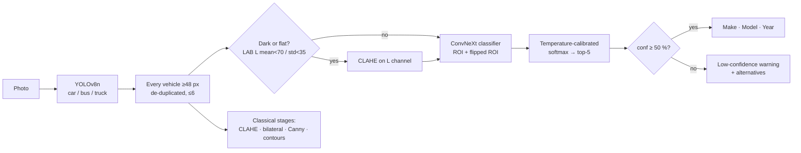

# Visionary — Fine-Grained Vehicle Recognition (P5)

**Upload a car photo → Visionary finds every vehicle and names its make, model and year
(196 Stanford Cars classes), with calibrated confidence and the intermediate
computer-vision steps.**

**▶ Live app:** https://visionalpha-visionary.static.hf.space
(runs entirely in your browser; photos never leave the device. The first visit downloads ~66 MB of models, then they're cached)

Team T20 · Problem Statement P5 · metrics: [`eval_P5_T20.md`](eval_P5_T20.md) ·
design: [`docs/design_document.md`](docs/design_document.md) ·
failures: [`docs/failure_cases.md`](docs/failure_cases.md)

---

## Results (official Stanford Cars test split, 8,041 images never used for training or tuning)

| Approach | Top-1 | Top-5 | CPU latency* |
|---|---|---|---|
| Classical only (HOG + LBP + HSV → PCA → logistic regression) | 19.0 % | 41.5 % | 19 ms |
| Deep learning only (ConvNeXt-Small on the full image) | 94.0 % | 99.3 % | 248 ms |
| **Hybrid — Visionary Pro** (YOLO ROI + CLAHE gate + ConvNeXt-Small @320 + flip-TTA) | **94.7 %** | **99.3 %** | 538 ms |
| Hybrid — Pro, INT8 (runs in the browser) | 94.4 %† | 99.4 %† | 287 ms |
| Hybrid — **Visionary Lite** (ConvNeXt-Tiny @224, browser default) | 94.0 % | 99.1 % | 206 ms (INT8 139 ms) |

\* end-to-end incl. detection, 2 CPU threads (median of 40 images). † 1,960-image stratified subset, identical to FP32 on the same images.

| Detection & confidence | |
|---|---|
| Mean IoU (YOLO box vs ground truth) | 0.93 (98.8 % of images ≥ 0.5) |
| mAP@50 / mAP@50:95 | 0.78 / 0.71 (only the main car is labelled → background cars count as FP) |
| Calibration error (ECE) | 16.8 % → **1.9 %** after temperature scaling |
| Accuracy when confident (≥ 50 %) vs flagged | 95.7 % vs 39.4 % |
| Browser vs Python parity | same accuracy on 300 test images, 98 % identical predictions |

Robustness (low light, glare, blur, noise, occlusion, viewpoint, low resolution) and the
full ablation are in [`eval_P5_T20.md`](eval_P5_T20.md).

---

## How it works



* **Classical CV** (`src/classical/`): CLAHE on the LAB lightness channel, bilateral
  denoising, auto-threshold Canny, contours, HOG/LBP/HSV descriptors.
* **Detection** (`src/detection/`): YOLOv8n, primary vehicle = largest area × confidence;
  all other vehicles are classified too.
* **Deep learning** (`src/classification/`, `scripts/train.py`): ImageNet-22k ConvNeXt
  fine-tuned on ground-truth box crops with random padding (so it matches imperfect
  detector crops), label smoothing, AdamW + cosine, mixed precision; temperature
  scaling on the validation split.
* **Hybrid engine** (`src/hybrid/engine.py`) and its browser port (`web/pipeline.js`)
  run the identical pipeline; `scripts/check_web_parity.py` verifies they agree.
* **Optimisation**: ONNX export + dynamic INT8 (`scripts/export_onnx.py`) — 3.5× smaller,
  same accuracy.

---

## Run it

**Option 1 — just open the live app** (link above). Try **🚗 Try a sample**, or drop any photo.

**Option 2 — one command with Docker** (serves the same app + a REST API on port 7860):

```bash
docker build -t visionary . && docker run -p 7860:7860 visionary
# open http://localhost:7860      ·      API: POST /api/predict (multipart "file")
```

**Option 3 — local Python** (Python 3.11):

```bash
pip install -r requirements-deploy.txt
pip install torch torchvision --index-url https://download.pytorch.org/whl/cpu
pip install --no-deps ultralytics ultralytics-thop
uvicorn app.main:app --port 7860
```

The trained weights live in `weights/` (and in the Hugging Face Space). Large files
are not committed to git — see *Reproduce* to regenerate them.

---

## Reproduce the results

```bash
# 1. data: Stanford Cars with boxes (+ the one class the mirror lacks)
python scripts/prepare_data.py                 # → data/prepared (train / val / test CSVs)
# 2. train (≈12 min Lite / ≈40 min Pro on an RTX 3050)
python scripts/train.py --backbone convnext_tiny.fb_in22k_ft_in1k  --img 224 --name convnext_tiny_224
python scripts/train.py --backbone convnext_small.fb_in22k_ft_in1k --img 320 --bs 16 --accum 2 --name convnext_small_320
python scripts/train_classical.py              # classical baseline
# 3. optimise, evaluate, report
python scripts/export_onnx.py --ckpt weights/convnext_small_320.pt
python scripts/evaluate.py   --ckpt weights/convnext_small_320.pt
python scripts/benchmark_latency.py --name convnext_small_320
python scripts/write_report.py --default convnext_small_320 --extra convnext_tiny_224   # → eval_P5_T20.md
# 4. browser build + parity check
python scripts/build_web.py --models convnext_tiny_224 convnext_small_320 --default convnext_tiny_224
pytest -q                                      # 49 tests (classical, detection, classifier, API incl. bad input)
```

`notebooks/stanford_cars_training_kaggle.ipynb` runs the same scripts on a free Kaggle/Colab GPU.

---

## Repository layout

```
app/main.py            FastAPI: serves web/ and /api/predict, /api/models, /api/benchmarks
web/                   in-browser app (ONNX Runtime Web + OpenCV.js) — deployed to HF Spaces
src/classical/         CLAHE, bilateral, Canny, contours, colour/texture/geometry features
src/detection/         YOLO wrapper, ROI crop, IoU, mAP
src/classification/    ConvNeXt wrapper, 196-class make/model/year metadata
src/hybrid/            hybrid engine (gate, multi-view, fusion, multi-vehicle), classical head
scripts/               data prep, training, export, evaluation, latency, report, web build
docs/                  design document, failure cases, demo & viva notes
tests/                 pytest suite
```

---

## Limitations & ethics

* **Coverage:** Stanford Cars is mostly US-market models from 1991–2012. Newer or
  regional (e.g. Indian-market) cars can't be named correctly; the app usually shows
  a low-confidence warning with the closest alternatives.
* **Hard cases:** facelift years (e.g. Bentley GT 2007 vs 2012), trims (Audi A5 vs S5),
  roof-up convertibles vs coupes — see [`docs/failure_cases.md`](docs/failure_cases.md).
* **Privacy:** no licence-plate reading, face recognition, tracking or storage; the
  browser app never uploads images.
* Intended for education and analytics, not for enforcement decisions.

**Dataset:** Stanford Cars (Krause et al., 2013), via Hugging Face mirrors
`naufalso/stanford_cars` and `tanganke/stanford_cars`. **Pretrained models:** timm
ConvNeXt (ImageNet-22k), Ultralytics YOLOv8n (COCO).
