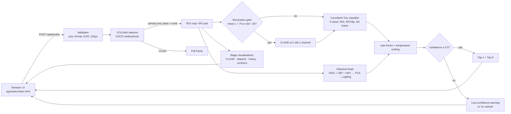

# Visionary — System Design Document

**Problem Statement:** P5 — Intelligent Fine-Grained Vehicle Recognition and Analysis System  
**Team:** T20  
**Dataset:** Stanford Cars (196 make/model/year classes, 8,144 train / 8,041 test images)  
**All numbers quoted here come from `eval_P5_T20.md` (official test split).**

---

## 1. Problem and goals

Given one photo, the system must:

1. find the vehicle and draw a bounding box,
2. name its **make, model and year** (196 fine-grained classes),
3. report a calibrated confidence and handle low-confidence or non-car inputs,
4. show the intermediate classical image-processing steps, and
5. quantify classical vs deep-learning vs hybrid performance.

The core difficulty is *fine-grained* recognition: many classes differ only by a
facelift year or trim (e.g. *Chevrolet Silverado 1500 Extended Cab* vs *Regular
Cab*), while real photos vary in lighting, angle, resolution and occlusion.

## 2. Architecture

Code map:

| Concern | Module |
|---|---|
| CLAHE, bilateral, Canny, contours, HSV/LBP, geometry | `src/classical/` |
| YOLO wrapper, ROI crop, IoU, mAP | `src/detection/` |
| ConvNeXt classifier, 196-class metadata (make/model/year/body) | `src/classification/` |
| Hybrid engine (gate, multi-view, fusion, thresholds), classical head | `src/hybrid/engine.py`, `src/hybrid/classical_head.py` |
| ONNX export + INT8 quantisation | `scripts/export_onnx.py` |
| HTTP API + UI | `app/main.py`, `app/static/index.html` |
| Training / evaluation / report | `scripts/prepare_data.py`, `train.py`, `train_classical.py`, `evaluate.py`, `write_report.py` |

## 3. Data

* Source: a Hugging Face mirror of Stanford Cars with bounding boxes
  (`naufalso/stanford_cars`). It is missing one class (174, *Ram C/V Cargo Van
  Minivan 2012* — the "/" broke its export); those 82 images are recovered from
  `tanganke/stanford_cars` and given YOLO pseudo-boxes. They are excluded from
  IoU/mAP because they have no ground-truth box.
* **Split:** train 7,356 / validation 788 (10 % of the official train set,
  stratified per class) / test 8,041 (official). The test set is never used for
  training, early stopping, calibration or fusion-weight tuning.

## 4. Component design and rationale

### 4.1 Detection (YOLOv8n)
COCO-pretrained YOLOv8-nano (6 MB) restricted to car/bus/truck. Primary vehicle =
the box maximising *area × confidence*, which picks the foreground car rather than
a distant one. Detection is reported with mean IoU and mAP against the dataset's
ground-truth boxes.

### 4.2 Fine-grained classifier (transfer learning)
* Backbone `convnext_tiny.fb_in22k_ft_in1k` (28 M params), new 196-way linear head.
* Trained on **ground-truth box crops with random 0–15 % padding per side**, so the
  classifier learns from inputs that look like real (imperfect) detector crops;
  15 % of samples use the full frame so it degrades gracefully if detection fails.
* Augmentation: horizontal flip, TrivialAugment, RandomErasing (occlusion proxy).
* AdamW, 1-epoch warm-up + cosine decay, label smoothing 0.1, AMP fp16,
  15 epochs on an RTX 3050 laptop GPU (~47 s/epoch).
* Best epoch picked on validation; **temperature scaling** fitted on validation
  (T = 0.55) brings the expected calibration error from ~19 % to ~2 %, so the
  displayed confidence is meaningful.

### 4.3 Classical computer vision
* **Illumination gate (adaptive):** CLAHE is applied only when the ROI is dark or
  flat (LAB lightness mean < 70 or std < 35). Unconditional CLAHE would change
  the colour/contrast statistics the network was trained on.
* **Visual pipeline for the UI:** CLAHE → bilateral denoise → auto-threshold Canny
  (median ± 33 %) → contours.
* **Classical classifier:** HOG (shape/silhouette gradients) + uniform LBP
  (texture) + 8×8×8 HSV histogram = 2,302-dim descriptor → standardise → PCA-256 →
  multinomial logistic regression. It is the *classical-only* baseline and an
  optional late-fusion branch.

### 4.4 Hybrid fusion
`p = (1 − w_cls) · [ (1 − w_full) · mean(p_ROI, p_ROI-flip) + w_full · p_full ] + w_cls · p_classical`

`w_full` and `w_cls` are grid-searched on the validation split only. The full-frame
view adds context (e.g. when the box clips a bumper); the flip view is cheap
test-time augmentation. The ablation table in `eval_P5_T20.md` shows the
contribution of each part; a component that does not help is reported honestly
and given weight 0.

### 4.5 Confidence handling
* `status = ok` when calibrated top-1 ≥ 50 %.
* `low_confidence`: the answer is shown as a *best guess* with a warning and the
  top-5 alternatives (typical for unseen 2013+ models, heavy occlusion).
* `no_vehicle`: no detector box **and** low confidence (cats, landscapes, documents).

### 4.6 Optimisation
* Checkpoint stored in fp16 (53 MB instead of 107 MB).
* Two variants: **Visionary Pro** (ConvNeXt-Small @320, 94.7 % Top-1) and
  **Visionary Lite** (ConvNeXt-Tiny @224, 94.0 %); the browser defaults to Lite
  for phone speed.
* ONNX export + dynamic INT8 weight quantisation (ONNX Runtime): 3.3–3.5× smaller,
  ≤ 0.3 pt change in Top-1; the browser runs the INT8 models, and both precisions are
  in the server model switcher. Accuracy/size/latency trade-off in `eval_P5_T20.md`.

### 4.7 Serving and UI
* FastAPI single process serves the API and the static UI; models load lazily and
  are cached; the default model is warmed up at startup.
* Errors (empty file, non-image, unsupported format, tiny image, >15 MB, internal
  failure) return clean JSON messages, never stack traces.
* UI: chat-style single page — upload/drag/paste, loading phases, bounding-box
  canvas, top-5 bars, "how I got this" panel with stage images and per-stage
  timings, benchmarks sheet, model switcher (Pro / Max / Lite) to fall back to a
  lighter model if the host is slow. Works on phone and desktop, light/dark.
* Deployment: one `Dockerfile` (CPU wheels) → Hugging Face Spaces (Docker SDK).

## 5. Evaluation protocol

`scripts/evaluate.py` runs every configuration on the same cached detections and
views, so the comparison is apples-to-apples:

* Top-1/Top-5 on all 8,041 test images; GT-crop accuracy as an upper bound.
* IoU / mAP@50 / mAP@50:95 on the 8,000 test images with GT boxes.
* Robustness: a fixed class-stratified test subset under 7 synthetic corruptions
  (low light, over-exposure, motion blur, noise, 35×45 % occlusion block,
  perspective/viewpoint warp, 80-px low resolution).
* Confidence: average confidence (correct vs wrong), flag rate, threshold sweep
  (coverage vs accuracy), ECE.
* CPU latency per image (deployment target), model size on disk.

## 6. Limitations

* **Domain:** Stanford Cars covers mostly US-market models from 1991–2012. A 2023
  car, or an Indian-market model, cannot be named correctly; the system will
  usually return low confidence and the nearest look-alikes.
* **Single-vehicle focus:** only the primary vehicle is classified.
* **Near-identical years/trims** remain the dominant error source (see
  `docs/failure_cases.md`).
* The robustness corruptions are synthetic approximations of real conditions.

## 7. Ethics and privacy

* No licence-plate reading, face recognition, tracking or storage: uploaded images
  are processed in memory and discarded.
* Dataset bias toward North-American vehicles is disclosed in the UI footer and
  here; predictions are presented with confidence and alternatives, not as fact.
* Intended for educational / analytic use, not law enforcement decisions.
