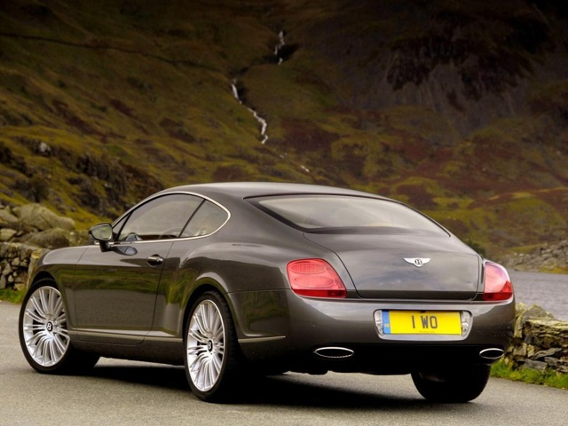
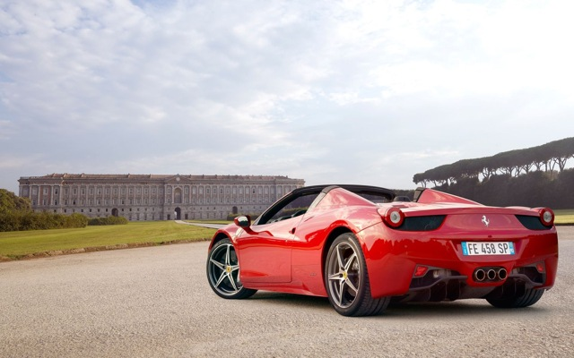
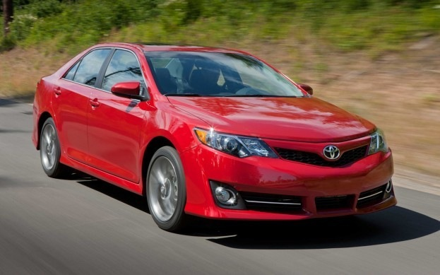

# Visionary — Failure-Case Analysis

All numbers come from `scripts/evaluate.py` on the official Stanford Cars **test
split (8,041 images never used in training)**, default model ConvNeXt-Tiny @224
hybrid pipeline (`weights/eval_convnext_tiny_224.json`). The hybrid makes
**483 errors (6.0 %)**. Mining the confusion matrix shows the errors are not
random — they fall into five explainable groups.

---

## Case 1 — Same car, different model year (facelifts)

| True class | Predicted as | Test errors |
|---|---|---|
| Bentley Continental GT Coupe **2012** | Bentley Continental GT Coupe **2007** | 11 |
| Dodge Caliber Wagon **2012** | Dodge Caliber Wagon **2007** | 9 |
| BMW 6 Series Convertible 2007 | BMW M6 Convertible 2010 | 10 |

**Why:** a mid-cycle facelift keeps the body shell and silhouette; only small
details change (headlight internals, bumper intakes, grille mesh). At 224 px those
details cover a few pixels, and each class has only ~40 training images. The
classifier therefore learns the *shape*, which is shared by both years.

**Evidence that it is hard, not a model-size problem:** the larger ConvNeXt-Small
at **320 px** (Visionary Pro) raises overall Top-1 from 94.0 % to 94.7 %, yet these
specific confusions barely move (Bentley GT 2012→2007: 11 → 10 errors; Dodge
Caliber 2012→2007: 9 → 10). More capacity and resolution alone do not separate
facelift years; the cue is too small and too rare in ~40 images per class.

**Mitigation:** higher input resolution / part-based attention on headlights and
grille; more training images per year.

## Case 2 — Same body, different trim or badge

| True class | Predicted as | Test errors |
|---|---|---|
| Audi S5 Coupe 2012 | Audi A5 Coupe 2012 | 12 |
| Audi TTS Coupe 2012 | Audi TT Hatchback 2011 | 13 (and 9 the other way) |
| Chevrolet Express Van 2007 | Chevrolet Express **Cargo** Van 2007 | 12 (and 8 the other way) |
| Audi V8 Sedan 1994 | Audi 100 Sedan 1994 | 11 |

**Why:** a performance trim (S5 vs A5, TTS vs TT) differs in badges, wheels and
exhaust tips; the Express passenger van and cargo van are the same vehicle with or
without side windows. These are the **worst classes in the dataset** (Express Van
48.6 % per-class accuracy, Express Cargo Van 58.6 %, Audi TTS 64.3 %). Some of
these errors are also likely **label noise** in Stanford Cars itself.

**Mitigation:** badge/wheel crops as extra views; hierarchical prediction (make →
model → trim) so the UI can say "Audi A5/S5 family" when the trim is uncertain.

## Case 3 — Convertible with the roof up vs coupe, and near-twins from one maker

Examples: *Ferrari 458 Italia Coupe → 458 Italia Convertible* and *Toyota Corolla
2012 → Toyota Camry 2012*, both predicted at **~100 % confidence** with a correct
YOLO box (IoU 0.94 and 0.86).

**Why:** a convertible with its roof closed has the coupe's silhouette; Toyota's
2012 sedans share the family front design. These are *confident* mistakes —
calibration is good on average (ECE 1.8 %) but cannot catch errors the model is
systematically sure about.

**Mitigation:** the top-5 list always shows the sibling as the runner-up;
fine-grained part features; training data with roof-up convertibles.

## Case 4 — Very low resolution (the only condition where the hybrid loses)

| Condition (robustness subset, 980 images) | Classical | DL only | Hybrid | Detected |
|---|---|---|---|---|
| clean | 17.7 | 92.4 | **93.3** | 99.0 % |
| low resolution (longest side 80 px, upscaled) | 9.3 | **66.5** | 64.5 | 89.6 % |

**Why:** after down-sampling to 80 px, YOLO misses ~10 % of cars and its boxes on
the rest are loose; cropping a blurry 80-px image removes context the full-frame
model can still use. In every other condition (low light, glare, blur, noise,
occlusion, viewpoint) the hybrid beats DL-only by 0.9–3.4 points.

**Mitigation:** fall back to the full frame (or fuse full-frame + crop) when the
detected box is smaller than ~64 px; the pipeline's `w_full` parameter supports
this but validation (clean images) set it to 0.

## Case 5 — Out-of-distribution cars (not one of the 196 classes)

Stanford Cars covers mostly US-market models from 1991–2012. Examples tried in the
demo:

* A **2010–2011 Ford Mustang coupe** or **Chevrolet Camaro coupe**: the dataset
  only contains the *Mustang Convertible 2007* and *Camaro Convertible 2012*, so
  the best possible answer is the convertible sibling.
* Modern (2015+) or Indian-market cars (e.g. Maruti, Tata, Mahindra models): the
  model returns the most similar class it knows.

**Why:** a closed-set classifier must pick one of its 196 labels; it has no
"none of these" option.

**What the system does:** the confidence is usually lower and the app shows a
**low-confidence warning** (< 50 %) with the top-5 alternatives. On the test set,
predictions under 50 % are right only **46.9 %** of the time versus **95.2 %**
above it, so the flag is meaningful. A 2.4 % flag rate costs little coverage.

**Mitigation:** open-set recognition (energy/Mahalanobis score on embeddings),
plus more recent training data.

---

## Confidence threshold trade-off (helps explain cases 3 and 5)

| Threshold | Coverage | Accuracy on accepted |
|---|---|---|
| 0.3 | 99.4 % | 94.3 % |
| 0.5 (used) | 97.6 % | 95.2 % |
| 0.7 | 93.9 % | 96.5 % |
| 0.9 | 87.1 % | 97.7 % |

Raising the threshold trades coverage for accuracy; 0.5 keeps 97.6 % of answers
while removing the least reliable ones.
